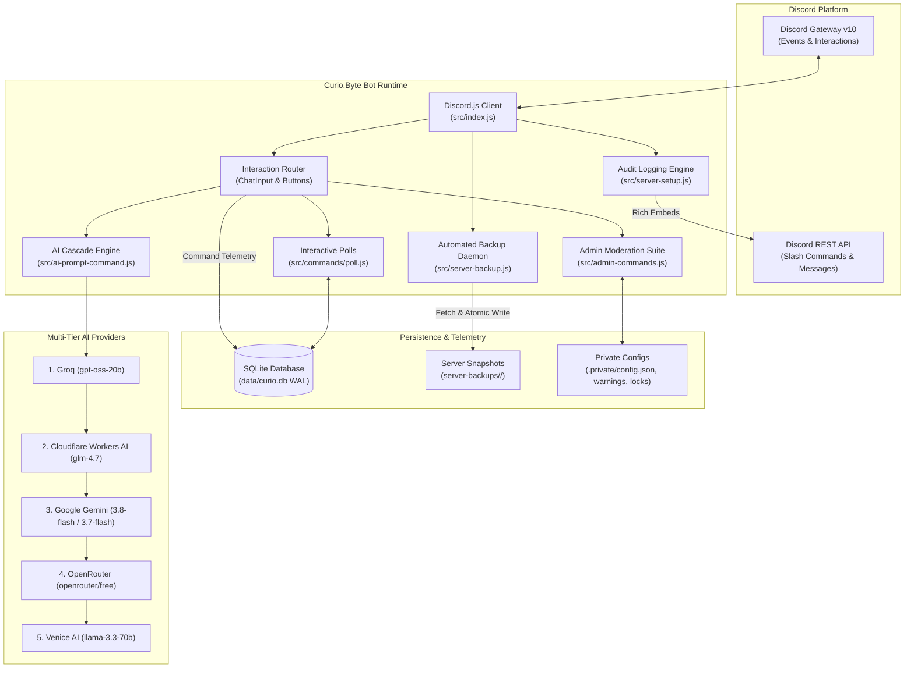

# Curio.Byte

[](https://nodejs.org/)
[](https://discord.js.org/)
[](https://www.sqlite.org/)
[](LICENSE)

**Curio.Byte** is a comprehensive Discord showcase companion, AI assistant, automated backup daemon, and server management bot built for the **Code, Build, Repeat** community. 

It provides an interactive programming portfolio showcase, a resilient multi-tier AI prompt routing cascade, automated 4-hour full-guild disaster recovery backups, SQLite-backed interactive polls and command telemetry, automated server auditing, and a complete administrative moderation suite.

---

## Project Documentation

- [Agent Guidelines](AGENTS.md) — Operational policies, mandatory GPG commit signing, secrets isolation, and coding standards.
- [Active Task Handoff](HANDOFF.md) — Operational state, running services, configurations, completed milestones, and immediate next steps.
- [Project Roadmap](ROADMAP.md) — Architectural phases, technical constraints, test isolation, and planned disaster recovery tooling.

---

## Core Capabilities



### 1. Interactive Portfolio Showcase
- `/about` — Bot mission, motto (*"Stay curious. Keep building. Repeat."*), and background.
- `/projects` — Overview of featured Code, Build, Repeat software projects with repository links.
- `/project [query]` — Fuzzy keyword and tag search across portfolio projects (e.g., `powershell`, `nodejs`, `backup`, `csharp`).
- `/languages` — Summary of supported languages, runtimes, and engineering philosophies.
- `/invite` — Ephemeral invite link builder with required permission scopes.
- `/help` — Complete contextual slash command listing.

### 2. Multi-Provider AI Routing Cascade
The `/ai-prompt` suite routes requests through an automated 5-tier fallback cascade with private ephemeral responses and automatic response chunking for long outputs:
1. **Groq:** `openai/gpt-oss-20b` (low-latency primary).
2. **Cloudflare Workers AI:** `@cf/zai-org/glm-4.7-flash` (edge compute fallback).
3. **Google Gemini:** `gemini-3.8-flash` (high-context reasoning; falls back to `gemini-3.7-flash` on temporary load).
4. **OpenRouter:** `openrouter/free` (broader model routing).
5. **Venice AI:** `llama-3.3-70b` (final privacy-preserving tier).

- `/ai-prompt ask prompt:<text> [context:<text>]` — Ask a technical question with automatic cascade fallback.
- `/ai-prompt test provider:<choice>` — Test an isolated AI provider directly without triggering fallbacks.

### 3. Persistent SQLite Engine (WAL Mode)
Powered by `better-sqlite3` in Write-Ahead Logging (`WAL`) mode (`data/curio.db`):
- **Command Analytics:** Ingests every command invocation with user ID, guild ID, and timestamp.
- **Guild Settings:** Persists designated log and chat channel IDs and audit status.
- **User Settings:** Persists personalized UI theme and notification preferences.
- **Interactive Button Polls (`/poll`):** Persists poll definitions, unique UUIDs, voter IDs, and real-time choice tallying. Prevents duplicate votes while allowing vote switching.
- **Server Health Dashboard (`/analytics`):** Real-time administrator overview of human vs bot counts, channel allocations, role governance, top SQLite command telemetry, and backup storage analytics.

### 4. Automated 4-Hour Guild Backup Daemon
Runs continuously in the background (`src/server-backup.js`), triggering every 4 hours (`INTERVAL_MS = 14400000`):
- **Full Structural Snapshots:** Captures guild settings, text/voice/category channels, active threads, permission overwrites, roles with bitfield permissions, member metadata and roles, webhooks (including tokens), custom emojis, stickers, bans, active invites, AutoMod rules, scheduled events, welcome screen, and integrations.
- **Atomic Persistence:** Writes to temporary files and renames atomically with restricted POSIX permissions (`0o600`).
- **Rolling Retention:** Preserves rolling 60 snapshot revisions under `server-backups/<guild_id>/` and updates `latest.json`.

### 5. Private Channel Provisioning & Audit Logging
- **Provisioning (`/curio-byte setup`):** Automatically creates or secures a private `Curio.Byte` category with `#logs` and `#chats` channels hidden from `@everyone` and accessible only to administrators and the bot.
- **Real-Time Event Auditing (16 Events):** Member joins/leaves, nickname updates, role assignments/revocations, timeouts, voice state mutations (channel moves, server mutes/deafs), channel CRUD, role CRUD, message edits (with old/new diff), message deletions, bulk deletions, member bans/unbans, server setting updates, and custom emoji modifications.

### 6. Full Administrative Moderation Suite
- **Member Discipline:** `/moderation ban`, `/moderation kick`, `/moderation timeout` (1 to 40,320 minutes).
- **Warning System:** `/moderation warn` (DM notification + logging), `/moderation warnings` (history lookup), and `/moderation clear-warnings` (persisted in `.private/warnings.jsonl`).
- **Message Purge:** `/moderation purge` (bulk deletion of 1–100 messages under 14 days old).
- **Channel Operations:** `/channel create`, `/channel edit`, `/channel delete`, `/channel lock`, `/channel unlock` (permission state preserved in `.private/channel-locks.json`).
- **Role Governance:** `/role create`, `/role edit`, `/role delete`, `/role add`, `/role remove`, `/role permission` (granular `PermissionFlagsBits` toggling).
- **Server Info:** `/server info` overview.

---

## Directory Structure

```text
curio-byte/
├── .logs/                          # Runtime service log outputs
│   ├── output.log                  # Standard stdout
│   └── error.log                   # Standard stderr
├── .private/                       # Local uncommitted secrets and state (git-ignored)
│   ├── config.json                 # Bot token, app ID, and AI API keys
│   ├── warnings.jsonl              # Persistent moderation warnings
│   └── channel-locks.json          # Saved permissions for locked channels
├── assets/                         # Static visual assets and bot icons
├── data/                           # SQLite database storage (git-ignored)
│   └── curio.db                    # WAL SQLite database (analytics, polls, settings)
├── server-backups/                 # Automated guild snapshot storage (git-ignored)
│   └── <guild_id>/                 # Guild backup directory
│       ├── backup-<timestamp>.json # Timestamped full guild snapshot
│       └── latest.json             # Symlinked/copied latest snapshot
├── src/                            # Application source code
│   ├── commands/                   # Modular slash command definitions & handlers
│   │   ├── analytics.js            # /analytics command handler
│   │   ├── poll.js                 # /poll interactive button handler
│   │   ├── project.js              # /project portfolio search handler
│   │   └── setup.js                # /curio-byte subcommand definitions
│   ├── admin-commands.js           # Full administrative moderation suite
│   ├── ai-prompt-command.js        # Multi-provider AI cascade routing
│   ├── db.js                       # SQLite schema & query statements
│   ├── deploy-commands.js          # Standalone REST command registration script
│   ├── index.js                    # Application entry point & gateway client
│   ├── server-backup.js            # Automated 4-hour snapshot daemon
│   └── server-setup.js             # Audit event listeners & private channel setup
├── test/                           # Unit and integration test suite
│   ├── ai-prompt-command.test.js   # AI fallback and provider tests
│   ├── db.test.js                  # SQLite CRUD & poll voting tests
│   └── server-setup.test.js        # Audit logging listener verification
├── Curio.Byte.example.service      # Example systemd service unit
├── Dockerfile                      # Container definition
├── docker-compose.yml              # Container orchestration
├── package.json                    # Dependencies (discord.js, better-sqlite3)
├── AGENTS.md                       # Operational rules and agent contract
├── HANDOFF.md                      # Active operational state and task handoff
├── README.md                       # This comprehensive documentation
└── ROADMAP.md                      # Architecture roadmap and milestones
```

---

## Configuration & Setup

### 1. Prerequisites
- Node.js 20.0.0 or 24.x+
- A Discord application and bot configured in the [Discord Developer Portal](https://discord.com/developers/applications).
- Privileged Gateway Intents enabled in Developer Portal under **Bot → Privileged Gateway Intents**:
  - **Server Members Intent** (`GuildMembers`)
  - **Message Content Intent** (`MessageContent`)

### 2. Installation
```bash
git clone https://github.com/daniel-kill/curio-byte.git
cd curio-byte
npm install
```

### 3. Configure Credentials
Copy the example configuration to the git-ignored `.private/` directory:
```bash
mkdir -p .private
cp config.example.json .private/config.json
```

Populate `.private/config.json`:
```json
{
  "botToken": "DISCORD_BOT_TOKEN_HERE",
  "applicationId": "DISCORD_APPLICATION_ID_HERE",
  "inviteUrl": "",
  "groqApiKey": "",
  "cloudflareAccountId": "",
  "cloudflareApiToken": "",
  "googleAIstudioApiKey": "",
  "openrouterApiKey": "",
  "veniceApiKey": ""
}
```

### 4. Running the Bot
```bash
# Register slash commands explicitly (or let the bot auto-register on start)
npm run deploy-commands

# Start the bot
npm start
```

---

## Production Deployment (Systemd User Service)

Curio.Byte is actively deployed as a **systemd user service** on `danielpredpc` (WSL2 / Linux).

### User Service Unit (`~/.config/systemd/user/curio-byte.service`)
```ini
[Unit]
Description=Curio.Byte Discord Bot
After=network-online.target
Wants=network-online.target

[Service]
Type=simple
WorkingDirectory=/home/daniel/Repos/curio-byte
Environment=NODE_ENV=production
Environment=DB_PATH=/home/daniel/Repos/curio-byte/data/curio.db
ExecStart=/home/daniel/.local/bin/node /home/daniel/Repos/curio-byte/src/index.js
Restart=on-failure
RestartSec=5s
TimeoutStopSec=15s
KillSignal=SIGTERM
UMask=0077
StandardOutput=journal
StandardError=journal

[Install]
WantedBy=default.target
```

### Service Management Commands
```bash
# Reload user daemon
systemctl --user daemon-reload

# Enable on boot & start service
systemctl --user enable --now curio-byte.service

# Check live service status
systemctl --user status curio-byte.service

# Inspect live journal logs
journalctl --user -u curio-byte.service -f
```
